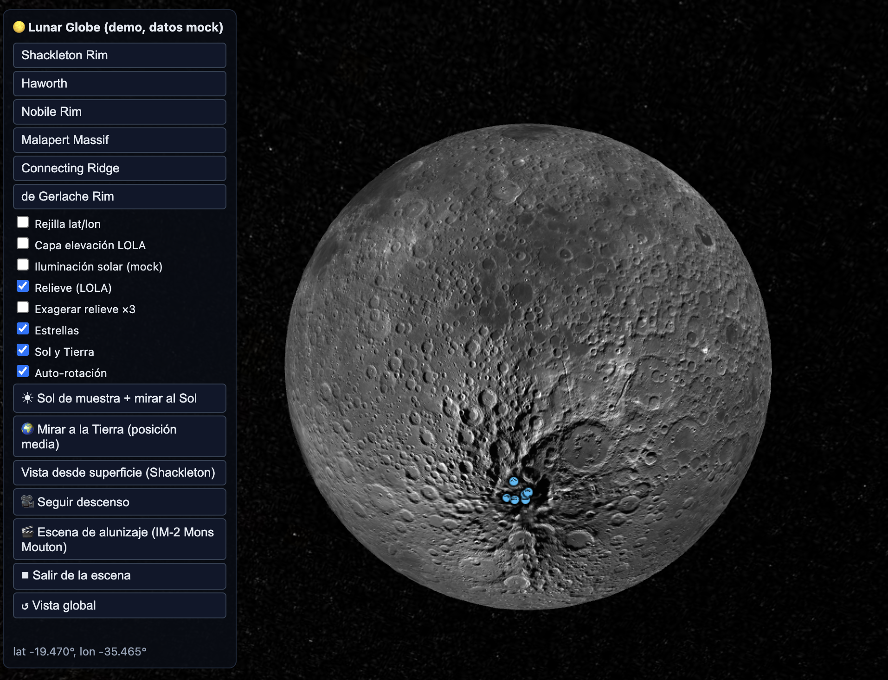
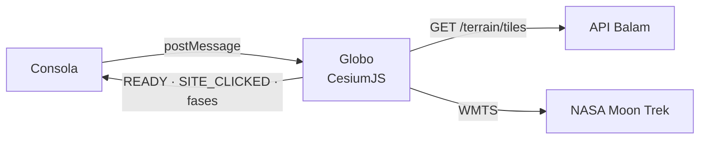

# Balam · Globo lunar 3D

Globo lunar 3D de **Balam — Lunar South Pole Landing Navigator**, del equipo **Jaguares Astrales** para el reto *Lunar Landing Site Navigator* de NASA Space Apps Challenge.

Una Luna estilo Google Earth hecha con **CesiumJS**: relieve LOLA real, el Sol y la Tierra en su posición calculada por la API, vista a ras de suelo con el horizonte real y una escena de alunizaje. Se incrusta en la [consola](https://github.com/CarlitooooK/luna-landing-navigator-console) como **iframe + postMessage**.

## Video

[](https://youtu.be/LZM5Rb74amw)

▶️ [Ver el recorrido en YouTube](https://youtu.be/LZM5Rb74amw)

## Qué hace

- **Toda la Luna en 3D:** imagen LROC WAC de NASA Moon Trek y relieve LOLA; con la API, el polo sur llega a ~21 m de detalle.
- **Sitios y regiones en sombra permanente (PSR)** sobre la superficie, con el color del veredicto GO / CAUTION / NO-GO.
- **Sol y Tierra** a su tamaño angular real, en la dirección que calcula la API (el globo no calcula efemérides).
- **Vista de horizonte:** la cámara baja al suelo del sitio y muestra cuándo el Sol y la Tierra quedan detrás del relieve.
- **Escena de alunizaje:** llegada, descenso, posado y astronauta (ilustrativa, no física).

<p align="center">
  
</p>
<p align="center"><sub>La demo independiente (<code>npm run dev</code>) con datos de muestra: sitios candidatos del polo sur sobre la imagen LROC WAC y el relieve LOLA.</sub></p>

## Cómo se usa

```html
<iframe src="https://HOST_DEL_GLOBO/?allowedOrigins=https://HOST_DE_LA_CONSOLA"></iframe>
```

El host le manda los datos por `postMessage` (`SET_SITES`, `SELECT_SITE`, `SET_SUN_LOCAL`…) y el globo responde `READY`, `SITE_CLICKED` y el avance de sus escenas. Solo acepta mensajes de los orígenes permitidos. El protocolo completo está en [`docs/02-protocolo-postmessage.md`](docs/02-protocolo-postmessage.md).



## Correr en local

Requisitos: Node 22 y npm.

```bash
npm ci
npm run dev    # copia los assets de Cesium y abre la demo en http://localhost:5173
```

Junto con la consola: `npm run dev -- --port 5174` y, en la consola, `VITE_GLOBE_URL=http://localhost:5174/`. Variables de entorno, CI y despliegue: [`docs/09-desarrollo-y-despliegue.md`](docs/09-desarrollo-y-despliegue.md).

## Documentación

| Doc | Qué tiene |
| --- | --- |
| [`docs/01-arquitectura.md`](docs/01-arquitectura.md) | Por qué CesiumJS y qué hace cada módulo |
| [`docs/02-protocolo-postmessage.md`](docs/02-protocolo-postmessage.md) | Protocolo con el host (fuente única) |
| [`docs/03-relieve-y-polo.md`](docs/03-relieve-y-polo.md) | Relieve y polo sur |
| [`docs/04-vista-horizonte.md`](docs/04-vista-horizonte.md) | Vista de horizonte |
| [`docs/05-escena-alunizaje-y-vehiculos.md`](docs/05-escena-alunizaje-y-vehiculos.md) | Escena de alunizaje y vehículos |
| [`docs/06-cielo-y-camara.md`](docs/06-cielo-y-camara.md) | Cielo, cámara, gestos y capas |
| [`docs/07-flujos.md`](docs/07-flujos.md) | Flujos en diagramas |
| [`docs/08-limitaciones.md`](docs/08-limitaciones.md) | Limitaciones conocidas |
| [`docs/09-desarrollo-y-despliegue.md`](docs/09-desarrollo-y-despliegue.md) | Desarrollo, CI y despliegue |

## Repos del proyecto

| Repo | Qué es |
| --- | --- |
| [`luna-landing-navigator-console`](https://github.com/CarlitooooK/luna-landing-navigator-console) | Consola web (React) |
| [`luna-render-nasa-space-challenge`](https://github.com/CarlitooooK/luna-render-nasa-space-challenge) | Este globo lunar 3D |
| [`lunar_landing_site_navigator_api`](https://github.com/AxelT456/lunar_landing_site_navigator_api) | API (FastAPI, PostGIS, LOLA, SPICE) |
| [`handoff-space-NASA-challenge`](https://github.com/CarlitooooK/handoff-space-NASA-challenge) | Contexto: reto, contrato, decisiones y ambientes |

## Datos y créditos

Imágenes LROC WAC y relieve LOLA de [NASA Moon Trek](https://trek.nasa.gov/moon/) y de la API del proyecto; la atribución aparece en el visor ("Data attribution"). Modelos 3D de NASA 3D Resources, sin modificar ([`public/models/ATTRIBUTION.md`](public/models/ATTRIBUTION.md)). Sin Cesium Ion ni tokens.
