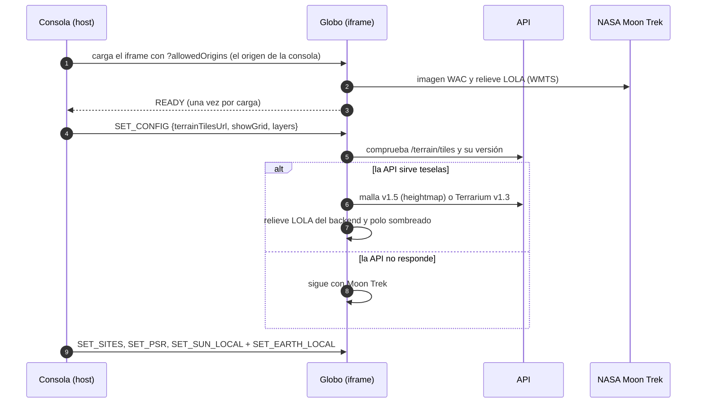
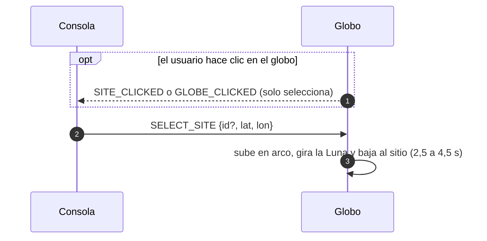
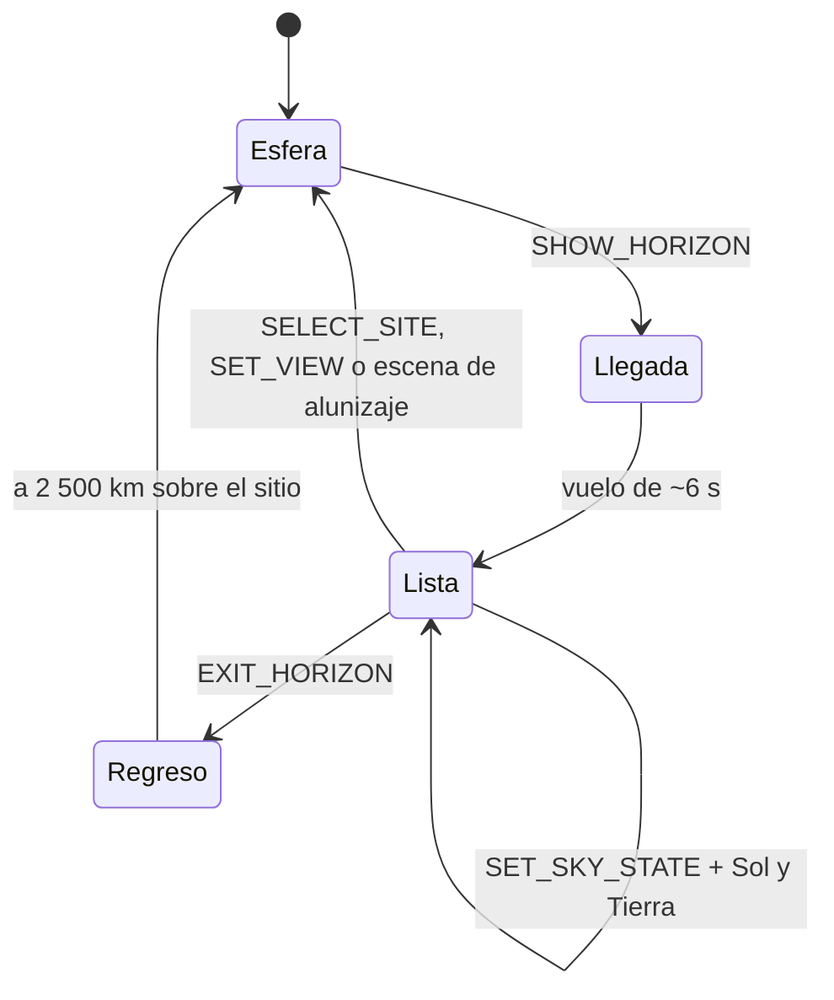
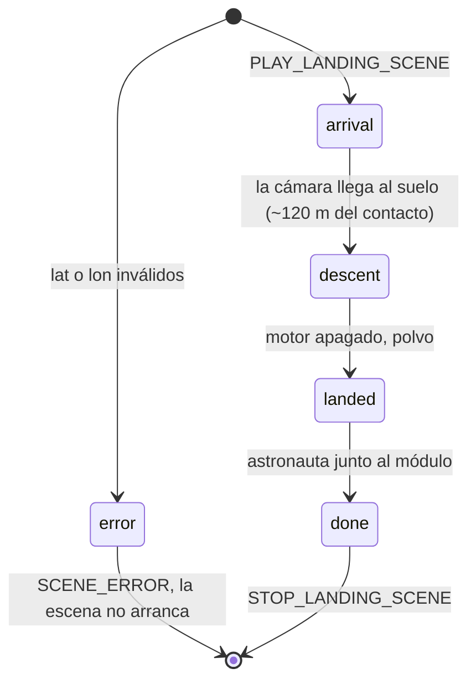

# 07. Flujos

Los flujos principales del globo en diagramas. GitHub dibuja los bloques `mermaid` directamente. Los mensajes y sus campos están en [`02`](02-protocolo-postmessage.md); si un diagrama choca con ese doc, manda él.

## Arranque dentro de la consola

Los mensajes de un origen que no está en `allowedOrigins` se ignoran, y el globo nunca responde a `'*'`.

## Elegir un sitio

## Vista de horizonte

El globo avisa cada cambio con `HORIZON_PHASE` (`arrival`, `ready`, `leaving`).

## Escena de alunizaje

`STOP_LANDING_SCENE` la cierra en cualquier fase. Cada fase llega a la consola como `SCENE_PHASE`, y durante el descenso `SCENE_TELEMETRY` cada 100 ms. La curva del descenso es ilustrativa, no física.
